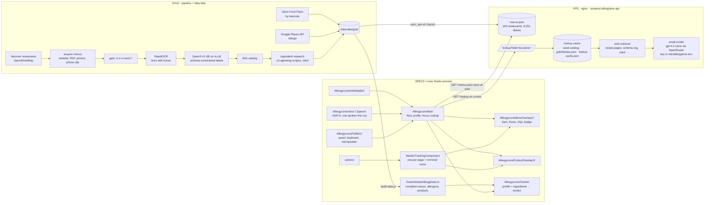

# AllergyLens — architecture

How the pieces fit, where every data set lives, and what happens at runtime
from the glasses to the server and back. Read with the [README](../README.md)
(how to run things) and [tools/scrape/DESIGN.md](../tools/scrape/DESIGN.md)
(pipeline design and source policy).

## 1. The system at a glance

Three places do work, with very different budgets:

| place | what runs there | when | budget |
|---|---|---|---|
| **SPECS (or the Lens Studio preview)** | the Lens: marker tracking, the allergen check, every pixel drawn, voice | every time the user looks | zero network for a known menu; must never stall |
| **VPS, `https://srv1619809.hstgr.cloud`** | `allergylens-api`: the menu catalogue, the dish lookup with its cache, the small model | once per session (catalogue) and once per unknown dish, cached for everyone | one small GET per session; model calls capped and cached |
| **GX10 (our GPU box)** | the scraping and reading pipeline, the local vision model, the data lake | once per restaurant, unattended | GPU time we own; no API bill |



## 2. Inside the Lens

All TypeScript on Spectacles Interaction Kit 0.18 and UI Kit, in
`Assets/Scripts/`.

| module | responsibility |
|---|---|
| `AllergyLensMain.ts` | The flow: profile → page recognised → check → point to check → card. Owns the profile, the head-locked UI scale, the grey backdrop, tracker focus, the remote catalogue and the lookup miss path. |
| `AllergyLensMenuOverlayUI.ts` | One per **marker** (a page can have several: print, design file, mirrored twins). Builds one *bar* per dish at its OCR box; draws the verdict only while pointed at; the badge chip; the motion gate; the ten-nearest cap. |
| `AllergyLensProductOverlayUI.ts` | One per label marker: outline, chip, pinch target. |
| `AllergyLensChecker.ts` | Pure functions: `checkDish`, `checkMenu`, `checkProduct`, `rateRestaurant`, the replacement rule. No scene access, fully unit-testable. |
| `AllergyLensMenuData.ts` | Typed access to the compiled data; merges a downloaded catalogue without ever losing a bundled menu. |
| `AllergyLensProfileUI.ts` | The three-step panel, toggles, chips, the own keyboard, the corner controls, the mic dot. |
| `AllergyLensProfileButtonUI.ts` | The draggable profile icon (SIK `InteractableManipulation`). |
| `AllergyLensDishDetailUI.ts` | The card on pinch. |
| `AllergyLensVoice.ts`, `AllergyLensSpeech.ts` | ASR session with echo stripping; pre-rendered speech clips, one line spoken by default. |
| `Assets/Data/AllergyData.ts` | Generated by `node tools/build-data.js` from `data/*.json`; never edited by hand. |
| `Assets/LeafTests/` | Eleven LEAF scenarios that drive the real Lens in the preview. |

**Tracking.** Every menu page is an image marker (`Assets/Markers/*.imgmarker`).
A page can carry several markers: the print flattened from a phone clip (best
alignment on that footage), the design file (what a live camera matches), and
a horizontally mirrored twin of each, because Lens Studio's webcam preview is
mirrored like a selfie. Whichever locks first owns the page; the others stay
quiet; a lost marker hands over to its twin. Once a page is found, only its
own trackers keep running until it has been out of view for a second.

**Positions.** The OCR step stores each dish's box as fractions of the page
image. The Lens knows the paper's width (21.59 cm), so every bar is placed in
centimetres on the page plane and follows the tracked pose. Nothing about a
frame ever leaves the device to draw a mark.

**The check** is string matching against `allergens.json` aliases ("ghee",
"whey" and "casein" all count as milk) plus the knowledge base's share keys.
It runs in microseconds, so the profile can change while a page is in view.

| verdict | source of the ingredient list | drawn (only while pointed at) |
|---|---|---|
| contains | the restaurant's own list | **red** line + chip "Contains chicken (not vegetarian), wheat (wheat flour, gochujang)." |
| contains / unverified | typical recipe, model, or nothing known | **grey** line + chip "May contain … Check with the restaurant." / "No ingredient list. Ask the restaurant." |
| safe | any list, nothing matched | **green** bare line |

**Interaction.** Nothing is drawn on recognition except the badge chip. The
pointer (finger on the glasses, mouse in the preview) must rest on a dish for
0.55 s; its verdict fades in over 0.2 s; the previous one fades out at once;
a verdict lingers 1.2 s after the pointer leaves. Pinch opens the card. The
page's lines are hidden while it moves fast.

## 3. Runtime flows

**Start.**
1. Compiled data is live immediately (tier 0).
2. The profile panel appears on a head-locked dim backdrop; the Lens says one
   line; mic and speaker are off until their buttons are pinched.
3. In parallel, `GET https://srv1619809.hstgr.cloud/menus.json` (about 3 MB,
   under two seconds). The response is validated against the Lens's own
   schema; on any failure the Lens keeps its bundled data. Bundled menus are
   kept and win on the same id.
4. The head-locked UI measures the camera's real projection every frame and
   scales to keep its share of the view (32° on the glasses, 66° on phone
   footage, 36° on the Mac camera).

**A page comes into view.**
1. A marker locks → `onMarkerFound(restaurantId)`. While the profile panel is
   open the page waits; on Done every page in view is picked up.
2. `checkMenu` runs for all dishes; bars get their verdict style but draw
   nothing; the badge chip shows "k of n safe".
3. Dishes with no ingredient list are queued for the miss path (below).
4. Pointing reveals one dish; pinching opens its card.

**The miss path (tiers 3–5).** `GET /lookup?dish=<name>&cuisine=<c>`:
cache (seed catalogue, `data-lake/gold/dishes.json`, `data/lookup-cache.json`)
answers in milliseconds; on a miss the server queues web retrieval of recipe
pages with schema.org markup, keeps the citations, and answers
`"researching"`; the Lens asks again at 8 s and 16 s; if retrieval finds
nothing, the small model returns a fixed JSON list of *typical* ingredients
plus a diet class, cached forever per dish, capped at 300 calls an hour.
Every tier's answer is stored with its source and shown as grey, never green.
Tier 5 (one down-scaled frame of an unknown menu to a vision model) is
designed, not deployed.

**A product label comes into view.** Same as a page: the label marker locks,
`checkProduct` judges the Open Food Facts ingredient and trace lists, the
outline and chip appear, pinch for the card.

## 4. Data sets and where they live

| data | file | source | committed? |
|---|---|---|---|
| allergens, aliases, groups, implications | `data/allergens.json` | curated | yes |
| dish knowledge base (typical ingredients, shares, substitutes, citations) | `data/dishes.json` | web retrieval, ≥3 agreeing recipes; curated seed | yes |
| restaurants, dishes, ingredients, layout boxes, marker image | `data/menus.json`, `data/menus/<id>/menu-1.png`, `menu-1.lines.json`, `menu-1.ocr.json` | OCR of a photo or phone clip; names corrected by hand | yes (seed set) |
| packaged products | `data/products.json`, `data/products/<id>/label-1.png` | Open Food Facts by barcode; one label read from a video | yes |
| compiled Lens data | `Assets/Data/AllergyData.ts` | `node tools/build-data.js` | yes (generated) |
| scraped lake: raw pages and images / tables / Lens-shaped JSON | `data-lake/bronze`, `silver`, `gold` | pipeline on the GX10 | no (git-ignored) |
| served catalogue | `menus.json` on the VPS | `gold/` synced by `tools/server/sync_vps.sh` | no |
| researched dishes | `data/lookup-cache.json` on the server | miss path | no |
| model key | `/etc/allergylens.env` on the server, root-only | — | never |
| recordings | `data/menus/menus-2026-11-07.mp4`, `data/products/groceries-2026-11-07.mp4` | the user's phone, untouched | yes |

## 5. Server and deployment

- `tools/serve_data.py`: a small Python HTTP service. Endpoints
  `/menus.json`, `/products.json`, `/lookup?dish=&cuisine=`, `/health`.
  ETag and CORS so the Lens and the preview can fetch from anywhere.
  `--research` turns on web retrieval, `--llm` the small model.
- VPS: `tools/server/install_vps.sh` installs node, a venv, the systemd unit
  `allergylens-api.service`, and the nginx site with a Let's Encrypt
  certificate, beside the other sites already on the box.
  `tools/server/sync_vps.sh` pushes the GX10's `gold/` catalogue, pulls the
  repo, restarts, and checks `/health`.
- GX10: `tools/scrape/run_pipeline.sh` runs the pipeline county by county in
  tmux; `allergylens-data.service` serves the same API locally and
  `allergylens-tunnel.service` keeps a tunnel URL as the fallback address.
- Security: the Lens holds no secrets. The only key is the model key on the
  server, with a hard spend cap at the provider. The Lens sends a dish name
  and a cuisine, never an image, never the user's profile.

## 6. The pipeline that reads a menu

```
discover (OpenStreetMap) → acquire (website, PDF, Places photos, own capture, phone clip via page_from_video.py)
→ gate_menu_images.py (is it a menu?) → ocr_menu.py / ocr_engines.py (RapidOCR: lines with boxes)
→ label_menu_lines.py (Qwen3-VL on vLLM; the model may only refer to numbered OCR lines, so it cannot invent a dish)
→ dish catalog → ingredients_rag.py (recipe pages, schema.org, voted across ≥3 recipes, citations kept)
→ allergens + category → data-lake/gold/ → menus.json → (sync) VPS → (build-data) Lens
```

Every stage is one script with one input and one output table, restartable,
and skips work it already did. A dish with fewer than three agreeing recipes
stays unknown (grey) rather than guessed.

## 7. How it was built and tested

- Planned with the Learn AR with SPECS skill pack (`devpost/design-brief.md`).
- Built by an AI coding agent through CLAD in Lens Studio 5.23.2 over the
  Lens Studio MCP: scripts, scene, markers, LEAF scenarios, pipeline.
- Tested with eleven LEAF scenarios (`Assets/LeafTests/`) that run the real
  Lens in the preview with a simulated hand and voice, plus the Mac camera as
  a live feed for manual runs. Verified in Lens Studio 5.23.2; 5.24.1
  migrates the project on open and is not used.

## 8. Measured numbers worth knowing

- Glasses view: 32.3° across (SPECS 27 simulation). Phone footage in the
  preview: 66.5°. Mac camera: 35.8°. Head-locked UI scales ×1 / ×2.26 / ×1.11.
- Model path accuracy on 150 dishes with trusted ingredients: 83 % of real
  "contains" caught, 90 % agreement with the trusted verdict. Hence grey, never green.
- Catalogue download: 193 restaurants, 8,251 dishes, ~3 MB, < 2 s. A cached
  `/lookup` answers in under a second; a researched dish in about 10 s.
